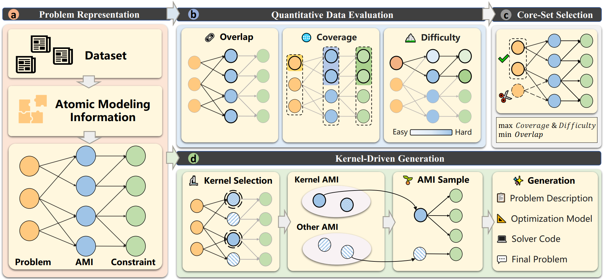

# Opt-Arena: Evaluating, Selecting, and Generating Optimization Modeling Data via Tripartite Graphs

**Accepted at NeurIPS 2026** · [Paper](https://openreview.net/forum?id=HKMOHcifiP) · [GitHub](https://github.com/Xu-Yian/Opt-Arena)

## Overview

Optimization modeling datasets often repeat familiar structures while underrepresenting other constraint patterns. Opt-Arena uses **Atomic Modeling Information (AMI)**—small, modeling-relevant pieces of a problem—to expose this imbalance. Linking problems, AMIs, and constraints in a tripartite graph provides a common representation for assessing structural coverage, redundancy, and difficulty.

The framework connects three goals: **evaluate** dataset structure, **select** informative problems with less redundancy, and **generate** problems by recombining AMI kernels with additional modeling information. This release contains analysis and generation interfaces, a score-based selection utility, reference catalogs, and an evaluation dataset.

## Framework

1. **Graph construction:** Extract AMIs, associate them with mathematical constraints, and classify problem and constraint types to form the Problem–AMI–Constraint graph.
2. **Data evaluation:** Measure structural coverage through observed AMI and constraint types, overlap through repeated AMI occurrences, and difficulty through constraint types and dimensionality. The analysis interface also aggregates dataset statistics.
3. **Data selection:** The paper's structure-aware Core-Set selection considers **Coverage**, **Overlap**, and **Difficulty** together under a data budget: retain modeling structures and challenging examples while avoiding repeated information. This is the research objective for the 5K training Core-Set; the released filtering script implements a narrower heuristic described below.
4. **Data generation:** Sample kernels for a problem type, add compatible AMIs from the catalog, and prompt a model to create descriptions and formulations. A second mode starts from kernels found in earlier analyses.

## Key Features

- Per-problem and JSONL batch analysis with AMI extraction, constraint classification, kernel matching, and difficulty scores.
- Dataset-level type distributions and AMI overlap summaries.
- Offline, coverage-preserving score filtering of annotated problems.
- Manual and analysis-guided problem generation.

## Released Datasets

| Dataset | Instances | Format | Description |
| --- | ---: | --- | --- |
| [Opt-Arena Eval](Opt-Arena%20Eval.jsonl) | 405 | JSONL | Evaluation problems with English questions, reference answers, and problem-type labels. |

**Opt-Arena Eval** provides question–answer instances for assessing optimization modeling across varied problem families. Its 55 problem-type labels provide breadth at the problem-type level; AMI-level structural diversity can be examined with the framework's evaluation methods. This **405-instance evaluation set is distinct from the paper's 5K training Core-Set**.

Each line is a JSON object with `en_question` (English problem statement), `en_answer` (reference answer stored as a string), and `problem_type` (problem-family label). All 405 records contain these three fields.

~~~python
import json

with open("Opt-Arena Eval.jsonl", encoding="utf-8") as f:
    records = [json.loads(line) for line in f if line.strip()]

print(len(records))  # 405
print(records[0]["problem_type"])
~~~

The five `data/` JSON files are reference catalogs, not additional problem splits: 56 problem types, 50 scored constraint types, 1,721 AMI group records, 536 classified AMI group records, and a kernel-combinations catalog.

## Repository Structure

~~~text
Opt-Arena Eval.jsonl   Evaluation question–answer records
data/                  Problem, constraint, AMI, and kernel reference catalogs
evaluation/            Analysis interface and difficulty-scoring scripts
seletion/              Score-based filtering and cleanup
generation/            Generation interface, prompt module, and annotation scripts
classify/              Problem and constraint classification scripts
graph_construction/    Numbered annotation and scenario stages
~~~

## Installation

Python 3.10 was used in the project's `vllm_eval` environment. From the repository root:

~~~bash
python -m pip install -r requirements.txt
~~~

Direct dependencies are `openai`, `pandas`, and `ijson`. Analysis and generation require an OpenAI-compatible API credential. Set `OPT_ARENA_API_KEY` and `OPT_ARENA_MODEL`, plus `OPT_ARENA_BASE_URL` if your provider needs a custom endpoint. See [.env.example](.env.example). Executing generated Gurobi code separately requires Gurobi and a suitable license.

## Usage

Run these commands from the repository root. Explicit catalog paths account for the current `data/` layout.

### Data Evaluation

~~~bash
export OPT_ARENA_API_KEY="your-api-key"
export OPT_ARENA_MODEL="your-model-name"
mkdir -p outputs
python evaluation/problem_difficulty_interface.py \
  --question "A factory allocates limited machine hours to maximize profit." \
  --problem-types-file data/problem_type.json \
  --constraint-catalog-file data/constraints_with_difficulty_scores.json \
  --atomic-groups-file data/atomic_info_all-2.json \
  --kernel-combinations-file data/kernel_combinations.json \
  --output outputs/analysis.json
~~~

For batches, use `--input-jsonl INPUT.jsonl --output-jsonl outputs/analysis.jsonl`. The input needs a supported question field such as `question`; the released dataset's `en_question` field requires mapping first. See [evaluation/DIFFICULTY_INTERFACE.md](evaluation/DIFFICULTY_INTERFACE.md) for accepted fields and results. Analysis invokes an API.

### Data Selection

The available script is a **score-based greedy heuristic**, not an implementation of the paper's complete Core-Set optimization method. It ranks annotated problems by weighted difficulty minus mean AMI occurrence count, then attempts to remove low-scoring problems without eliminating the last occurrence of an AMI or scenario. It reads `6-with_difficulties_valid_scenarios_only.json` and `atomic_info_occurrences.json` from `OPTMATH_DATA_DIR`. Point it to a directory containing those inputs:

~~~bash
OPTMATH_DATA_DIR="/path/to/annotated-data" python seletion/filter_problems_by_score.py
~~~

It tries to retain 5,000 problems while preserving AMI and scenario coverage, and writes `filtered_kept_problems_200.json` and `filtered_deleted_problems_200.json` to the same directory. The `_200` suffix is an existing filename, not the target size. This step runs offline.

### Data Generation

~~~bash
python generation/problem_generation_interface.py \
  --mode manual --type-counts '{"Production Planning Problem": 1}' \
  --problem-types-file data/problem_type.json \
  --kernels-file data/kernel_combinations.json \
  --atomic-all-file data/atomic_info_all-2.json \
  --constraints-file data/constraints_with_difficulty_scores.json \
  --output-jsonl outputs/generated.jsonl
~~~

For kernel-guided generation from analysis output, use `--mode similar --analysis-jsonl outputs/analysis.jsonl` instead of `--mode manual --type-counts ...`. See [generation/GENERATION_INTERFACE.md](generation/GENERATION_INTERFACE.md) for modes and output fields. Generation invokes an API.

## Reproducibility

The release includes Opt-Arena Eval, reference catalogs, and analysis and generation interfaces. Reproducing the complete study requires the annotated training data, intermediate artifacts, and model configuration used in the paper. The 5K training Core-Set is separate from the 405-record evaluation set.

## Citation

Please cite the [paper](https://openreview.net/forum?id=HKMOHcifiP). Machine-readable metadata is in [CITATION.cff](CITATION.cff).

~~~bibtex
@inproceedings{xu2026optarena,
  title = {Opt-Arena: Evaluating, Selecting, and Generating Optimization Modeling Data via Tripartite Graphs},
  author = {Yian Xu and Xiongwei Han and Jie Wang and Haoyang Liu and Yuyang Cai and Boxuan Niu and Mingxuan Yuan},
  booktitle = {The Fortieth Annual Conference on Neural Information Processing Systems},
  year = {2026},
  url = {https://openreview.net/forum?id=HKMOHcifiP}
}
~~~

## License

Code and documentation are under the [MIT License](LICENSE). The five reference catalogs in `data/` are byte-identical to the files covered by [DATA_LICENSE.md](DATA_LICENSE.md) under CC BY 4.0; that document still names the constraint catalog with its former `-train` suffix. The current license files do not specify terms for `Opt-Arena Eval.jsonl`; its rights holder must confirm them before publication.
